# FleetPulse

[](https://github.com/Parv-0210/fleetpulse-devops-capstone/actions/workflows/ci-cd.yml)

FleetPulse is a small app for keeping track of a fleet of vehicles and their servicing. It's my final
capstone project for the DevOps course (Session 21).

The idea came from a simple question: which of our vans is about to miss its next service? Every vehicle
has an odometer reading, a service interval (say every 10,000 km) and the reading at its last service.
From those three numbers the app works out how many kilometres are left and puts each vehicle into one
of three buckets:

- **OK** – plenty of distance left
- **Due soon** – 500 km or less to go
- **Overdue** – it should already have been serviced

When you log a service (oil change, tyres, brakes and so on) the counter resets. The dashboard shows the
vehicles that need attention first, along with how much was spent on maintenance in the last 30 days.

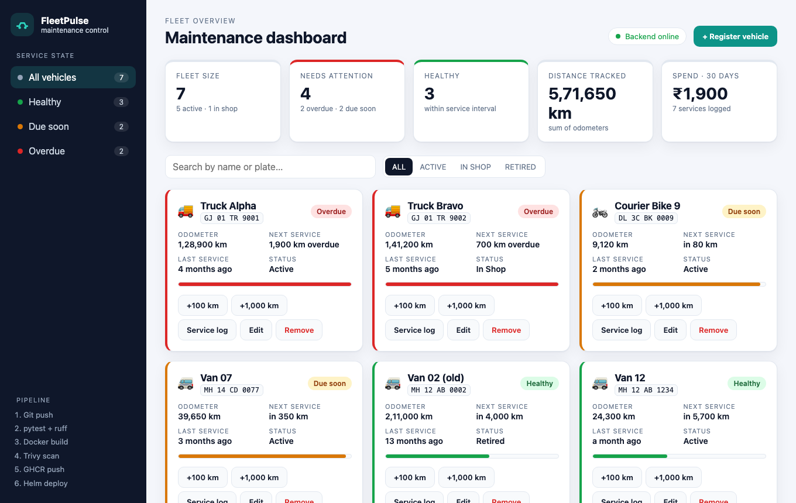

The app itself is intentionally modest. Most of the work in this repo is the path around it: tests,
containers, a CI/CD pipeline with a security gate, AWS infrastructure written in Terraform, a Helm chart
for Kubernetes, and monitoring with Prometheus and Grafana.

## How a change reaches production

```text
git push
  │
  ▼
GitHub Actions
  ├── backend:  ruff, pytest against PostgreSQL, Alembic upgrade/downgrade check
  ├── frontend: unit tests, Vite build
  ├── infra:    helm lint, terraform validate
  ├── security: CodeQL (SAST), pip-audit + npm audit (SCA), secret scan, IaC misconfig scan
  │
  ├── build both Docker images (amd64 + arm64)
  ├── Trivy scan (any fixable HIGH or CRITICAL CVE stops the pipeline here)
  ├── push to ghcr.io/parv-0210/fleetpulse-{backend,frontend}:<commit sha>
  │
  ├── deploy to a throw-away kind cluster inside CI, helm test, curl the API
  └── helm upgrade --install on EKS
        ├── Ingress:  /  → React app (nginx)    /api → FastAPI
        ├── 2+ replicas each, HPA on the backend, PodDisruptionBudgets
        └── ServiceMonitor → Prometheus → Grafana dashboard
```

Images are tagged with the commit SHA and never with `latest`, so any running pod can be traced back to
the exact commit that produced it.

## What's in it

| Part | What I used |
|---|---|
| Frontend | React 19 and Vite, plain CSS, served by an unprivileged nginx image |
| Backend | FastAPI, SQLAlchemy 2, Pydantic, Alembic |
| Database | PostgreSQL 16 |
| Tests | pytest (19 tests), ruff, Node's built-in test runner for the frontend helpers |
| Containers | Multi-stage Dockerfiles, both images run as non-root users |
| CI/CD | GitHub Actions (two workflows, 13 jobs), GitHub Container Registry, Trivy, CodeQL, pip-audit, npm audit |
| Infrastructure | Terraform: a VPC with public and private subnets, an EKS cluster with a managed node group |
| Kubernetes | A Helm chart with Deployments, Services, Ingress, HPA, PDBs and a Helm test |
| Monitoring | kube-prometheus-stack, with a Grafana dashboard that ships inside the chart |

## Things I did a bit differently

The course reference project is a task board. I wanted my own domain and a few touches that made the
DevOps side more interesting to build and to demo.

- **Two related tables instead of one.** Vehicles and service records, with the schema built up over two
  Alembic migrations, so the project shows a schema actually changing over time.
- **Metrics about the fleet, not just about HTTP.** Besides request counts and latency, `/metrics` reports
  how many vehicles are OK, due soon or overdue. The Grafana dashboard shows the health of the fleet next
  to the health of the API.
- **The dashboard is part of the deployment.** It lives in the Helm chart as a ConfigMap and Grafana
  picks it up automatically, so nobody has to import JSON by hand.
- **Safe migrations with more than one replica.** Each backend pod runs migrations in an init container
  that takes a PostgreSQL advisory lock first. When two pods start at the same moment, one migrates and
  the other waits. A pod only reports ready once the tables exist.
- **Images that pass the security gate.** My first Trivy scan found 4 HIGH issues in the backend image
  and 41 HIGH or CRITICAL issues in the frontend image. I removed pip from the runtime image and moved to
  a newer, patched nginx base, and both now scan clean. The details are in [docs/TRIVY.md](docs/TRIVY.md).
- **Locked-down pods.** Containers run as non-root with a read-only filesystem and all Linux
  capabilities dropped, and the namespace enforces the Pod Security "baseline" profile.

## Running it on your machine

You need Docker. Then:

```bash
git clone https://github.com/Parv-0210/fleetpulse-devops-capstone.git
cd fleetpulse-devops-capstone
docker compose up --build
```

- Dashboard: http://localhost:3000
- API docs (Swagger): http://localhost:8000/docs
- Health and metrics: http://localhost:8000/health and http://localhost:8000/metrics

A few sample vehicles are added the first time it starts, so the dashboard isn't empty. If port 3000 is
already taken, use `FRONTEND_PORT=3030 docker compose up --build` and open port 3030 instead.

To stop it, run `docker compose down`. Add `-v` if you also want to delete the database.

### Without Docker

You'll need Python 3.12 (I use `uv`), Node 22 and a PostgreSQL database.

```bash
make venv          # backend virtualenv and dependencies
make test          # pytest -v
make lint          # ruff

cd backend
cp .env.example .env              # point DATABASE_URL at your PostgreSQL
.venv/bin/python -m app.migrate   # create the tables
.venv/bin/uvicorn app.main:app --reload

# in a second terminal
cd frontend && npm ci && npm run dev    # http://localhost:5173, /api is proxied to :8000
```

`make check` runs everything the pipeline checks: lint, both test suites, the frontend build, Helm lint
and Terraform validation.

## The API

| Method | Path | What it does |
|---|---|---|
| GET | `/health` | Liveness check. The process is up. |
| GET | `/ready` | Readiness check. The database answers and the tables exist. |
| GET | `/metrics` | Prometheus metrics |
| GET | `/api/vehicles` | List vehicles. Filter with `?status=ACTIVE` or search with `?q=van`. |
| POST | `/api/vehicles` | Add a vehicle. Returns 409 if the number plate already exists. |
| GET | `/api/vehicles/{id}` | Get one vehicle |
| PUT | `/api/vehicles/{id}` | Update a vehicle, for example a new odometer reading |
| DELETE | `/api/vehicles/{id}` | Remove a vehicle and its service history |
| GET | `/api/vehicles/{id}/services` | Service history, newest first |
| POST | `/api/vehicles/{id}/services` | Log a service. This resets the maintenance counter. |
| DELETE | `/api/services/{id}` | Delete a service record |
| GET | `/api/fleet/stats` | The numbers behind the dashboard cards |

## Deploying to AWS

The full steps are in [terraform/README.md](terraform/README.md) and [k8s/README.md](k8s/README.md).
In short:

```bash
cd terraform
cp terraform.tfvars.example terraform.tfvars
terraform init
terraform plan
terraform apply                                  # about 15 minutes
$(terraform output -raw configure_kubectl)       # point kubectl at the new cluster

cd ..
kubectl apply -f k8s/namespace.yaml
kubectl apply -f k8s/storageclass-gp3.yaml
./k8s/bootstrap/ingress-nginx.sh
./monitoring/install.sh
./scripts/deploy.sh prod                         # Helm, using the current commit SHA
```

To let the pipeline deploy on every push to `main`, set the repository variable `DEPLOY_ENABLED` to
`true`. Also add the variables `AWS_REGION`, `EKS_CLUSTER_NAME` and `INGRESS_HOST`, and the secrets
`AWS_ACCESS_KEY_ID` and `AWS_SECRET_ACCESS_KEY`. No credentials are stored in this repository.

The cluster costs real money while it's running, roughly 0.25 USD an hour. Run `terraform destroy` once
you're done.

### Trying it on minikube

If you don't want to spend anything, the whole Kubernetes side runs on minikube:

```bash
make k8s-up        # starts minikube, builds and loads the images, installs the chart
make monitoring    # Prometheus and Grafana
make k8s-status
```

## Evidence by grading module

Everything below was captured from this repository running on my laptop (Docker Compose and a
minikube cluster) and from the public GitHub pages of this project.

### M1 · Application

| Dashboard (desktop) | Dashboard (phone width) |
|---|---|
|  | 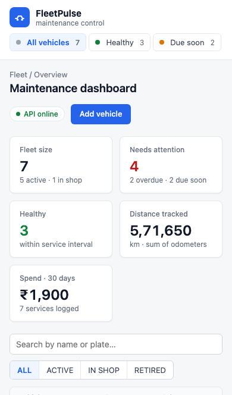 |

### M2 · Tests

`pytest -v` — 19 tests, all passing, against an isolated test database.

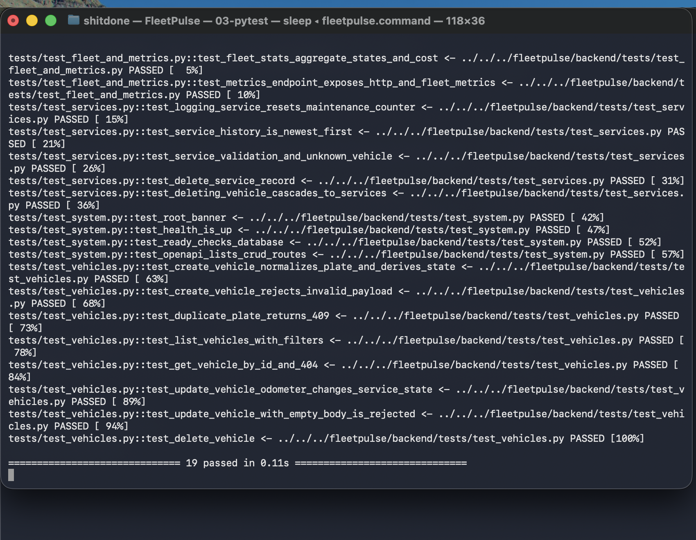

### M3 · Git and GitHub

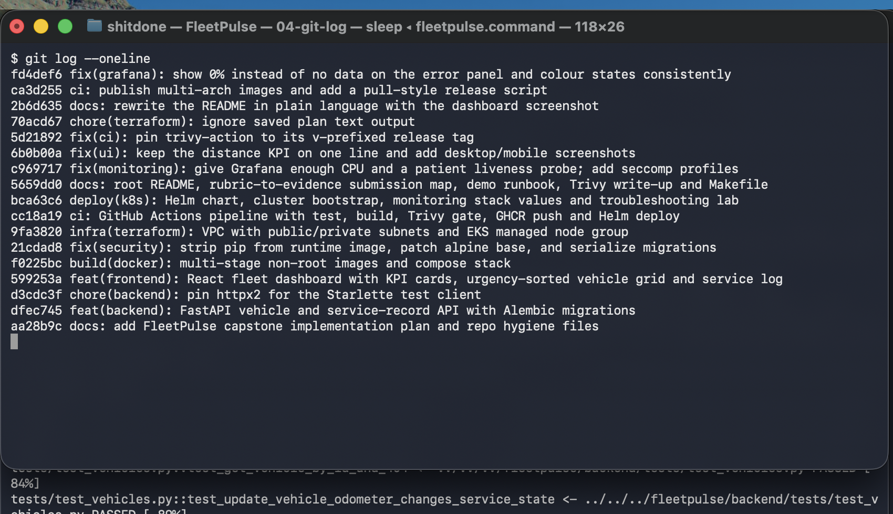

### M4 · Docker

`docker compose up --build` with all three services up, both images running as non-root users.

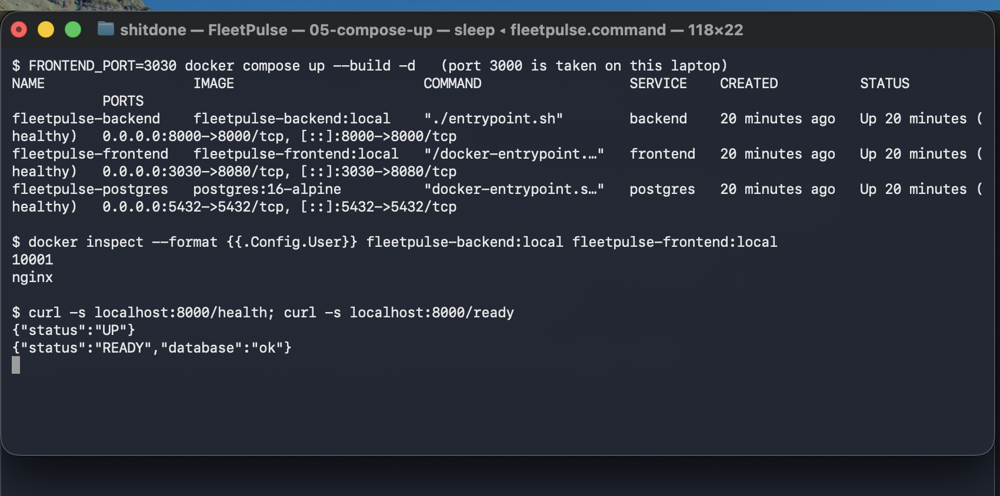

### M5 · CI/CD pipeline

Green run with every job: tests, frontend build, infra validation, both images built, scanned and pushed.
Images in GHCR are tagged with the commit SHA.

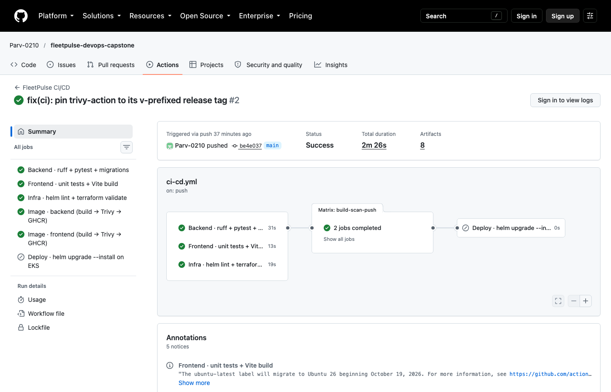


### M6 · Trivy

The gate step from the pipeline log: HIGH/CRITICAL scan on both images, zero findings.
See [docs/TRIVY.md](docs/TRIVY.md) for what was found before the images were hardened.

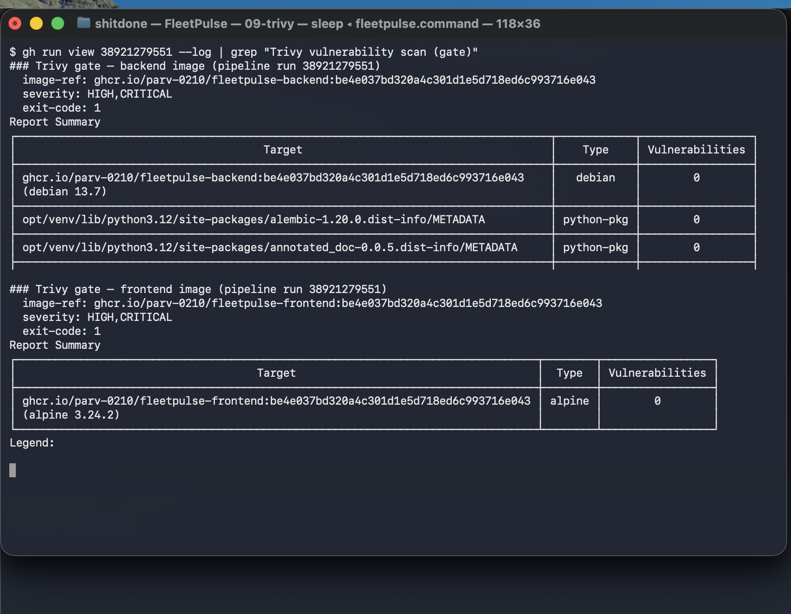

### M7 · Terraform

`terraform init`, `fmt` and `validate` pass locally and in CI. The plan/apply/destroy and AWS console
screenshots are pending: the AWS account I have access to has an organisation policy that denies EC2 and
EKS in every region, so they will be added as soon as an account without that restriction is available.

### M8 · Kubernetes and Helm

| Pods, HPA and PDBs | Services and Ingress |
|---|---|
| 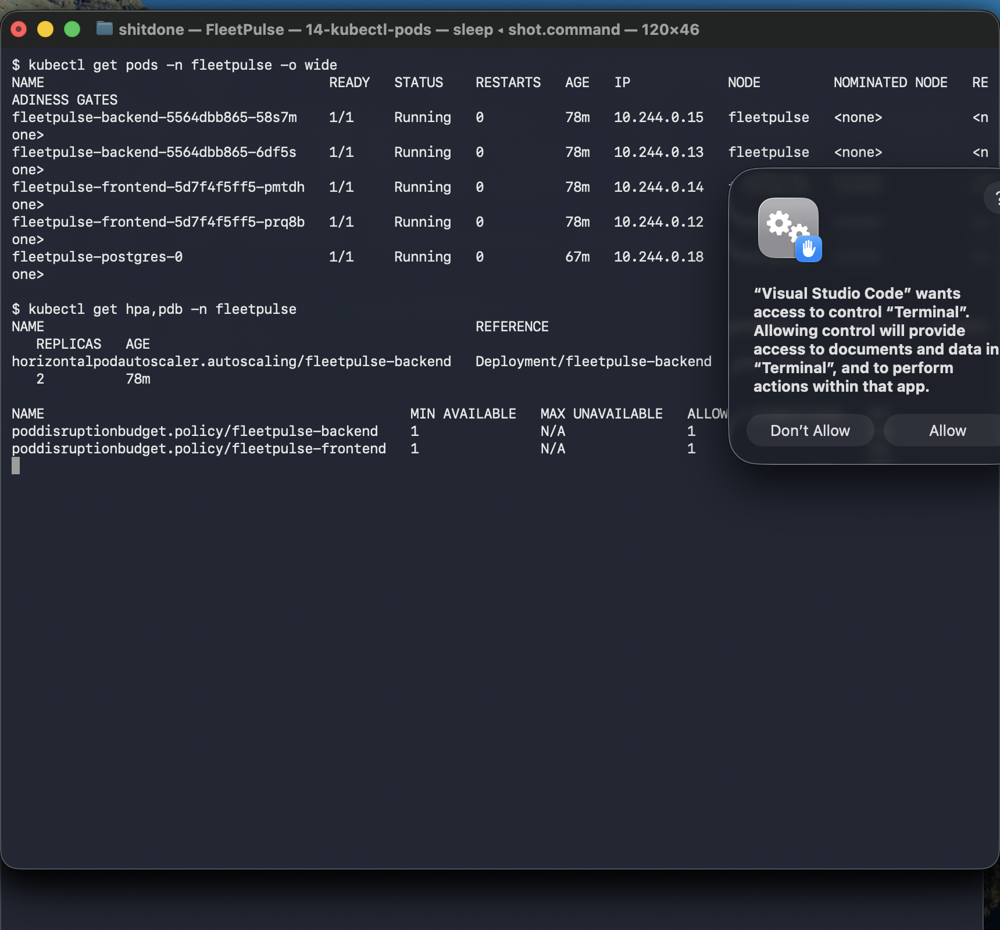 | 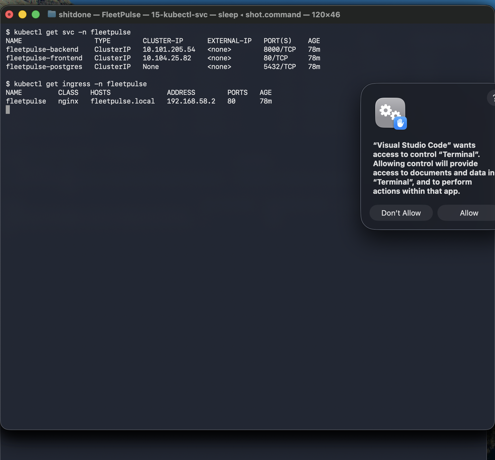 |

| Helm release and `helm test` | App served through the Ingress controller |
|---|---|
| 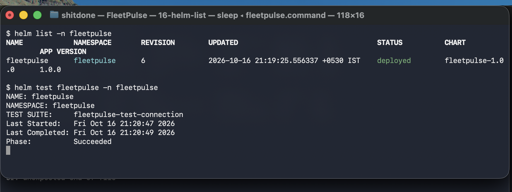 | 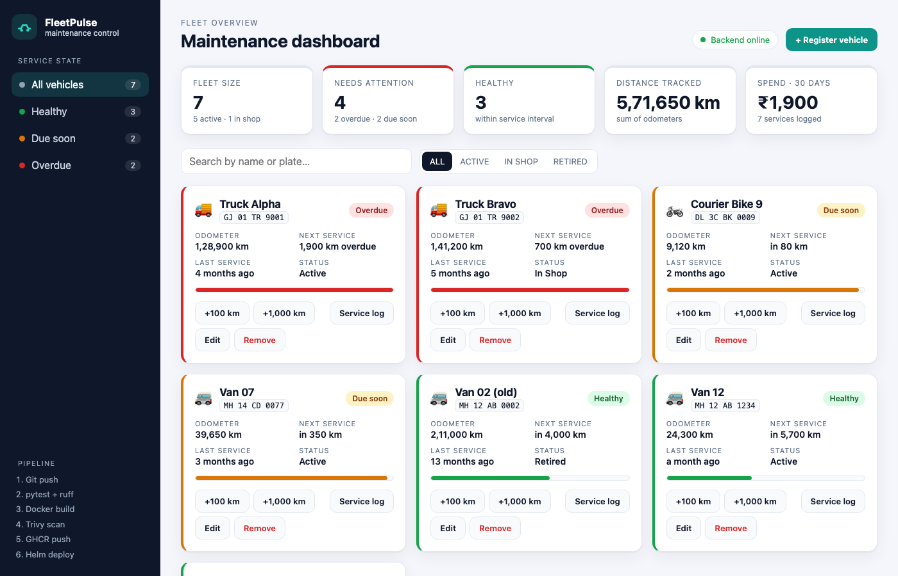 |

### M9 · Observability

`/metrics` from the backend, the Prometheus Targets page with both backend pods UP, and the Grafana
dashboard that the Helm chart installs.

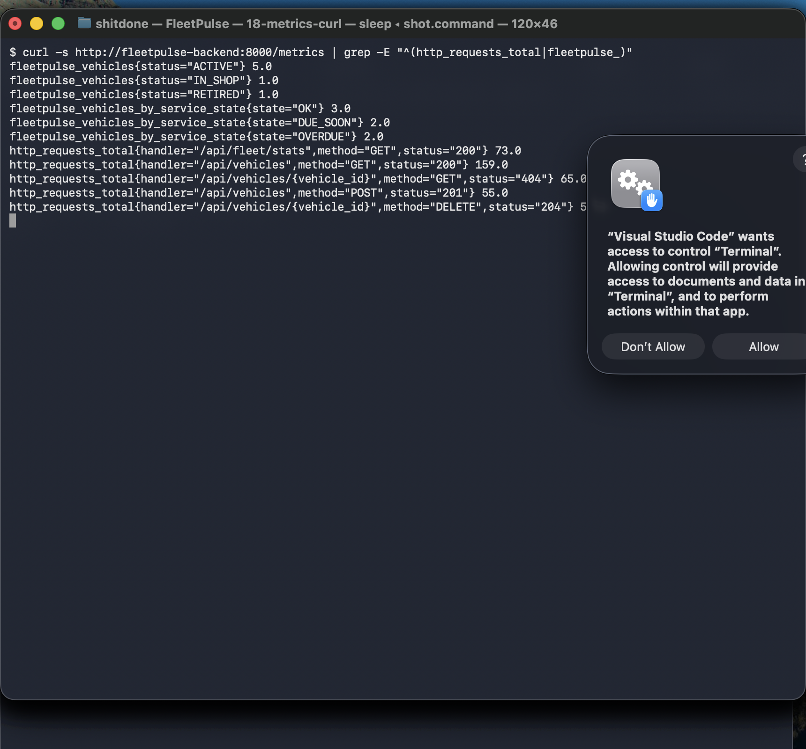

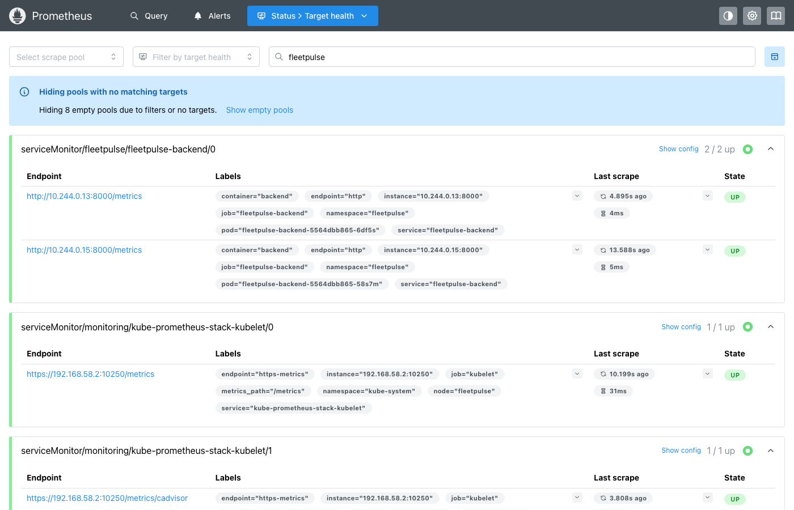

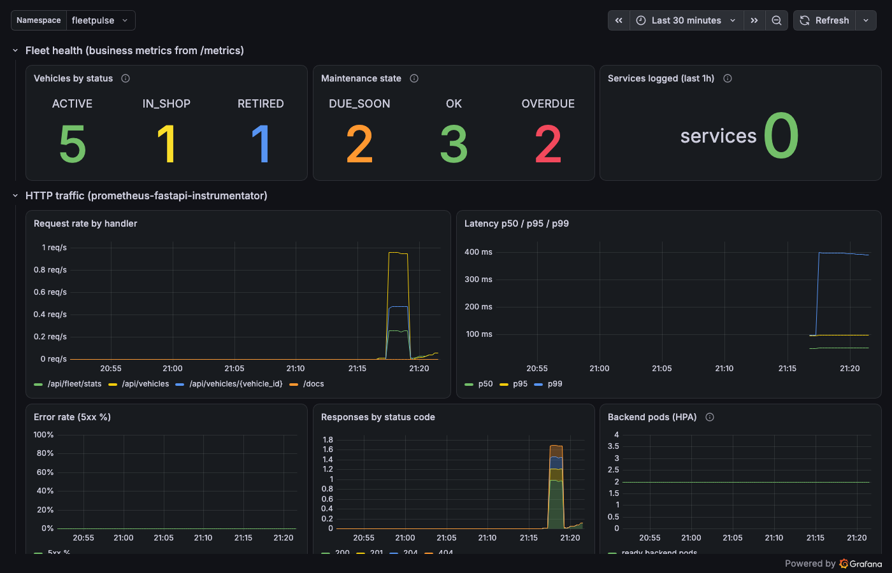

### M10 · Live demo

The recorded walkthrough (commit → pipeline → new image → cluster rollout) is linked in
[docs/DEMO.md](docs/DEMO.md).

## Repository layout

```text
backend/            FastAPI app, Alembic migrations, tests, Dockerfile
frontend/           React app, nginx config, Dockerfile
docker-compose.yml  Local stack: postgres, backend, frontend
.github/workflows/  The CI/CD pipeline
terraform/          AWS VPC and EKS
k8s/                Namespace, storage class, cluster bootstrap scripts
helm/fleetpulse/    Helm chart, including the Grafana dashboard
monitoring/         Prometheus and Grafana settings and install script
troubleshooting/    Two deliberately broken manifests for practising debugging
scripts/            Load test, deploy and minikube helpers
docs/               Plan, grading checklist, demo script, Trivy notes, screenshots
```

## More documentation

- [docs/PLAN.md](docs/PLAN.md) is how I planned the project before building it.
- [docs/SUBMISSION.md](docs/SUBMISSION.md) maps every grading criterion to the file or screenshot that covers it.
- [docs/DEMO.md](docs/DEMO.md) is the script for the live demo.
- [docs/TRIVY.md](docs/TRIVY.md) explains what the security scan checks and what I fixed.
- [troubleshooting/README.md](troubleshooting/README.md) covers the debugging exercises.
